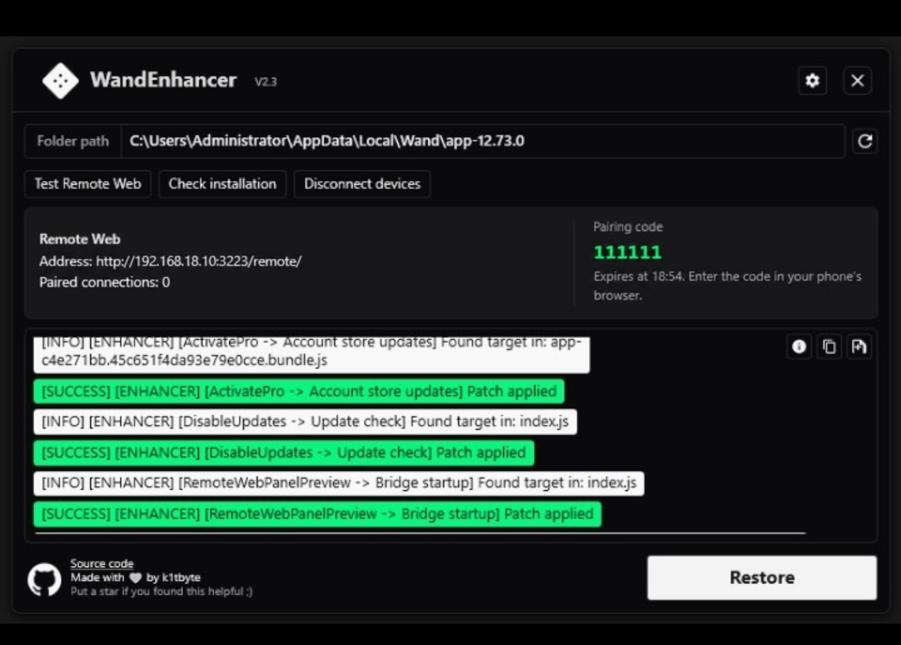
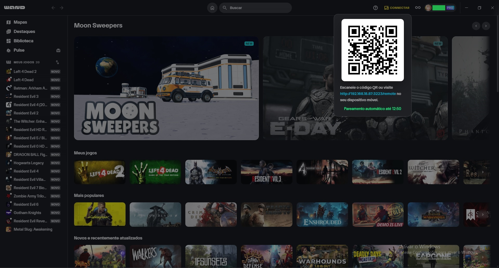
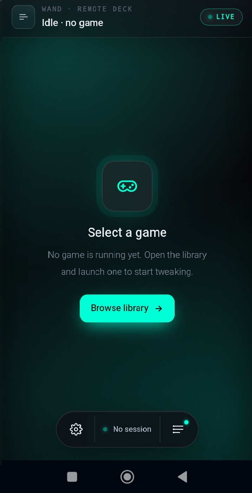

# WandEnhancer — Community Executable

**QR pairing • Local network diagnostics • Brazilian Portuguese support**

An independent community continuation of WandEnhancer, originally created by **k1tbyte** with contributions from the upstream community. This repository documents the compiled **WandEnhancer.exe**, its main features and the updated Remote Web connection process.

[Original project](https://github.com/k1tbyte/Wand-Enhancer)

## Download and requirements

[**DOWNLOAD EXECUTABLE**](https://github.com/lmedeiros01/Wand-Enhancer/releases/download/WandEnhancerExecutable/WandEnhancer.Windows.x64.exe)

Download the executable directly and run it on Windows; compilation tools and GitHub Actions are not needed to use it.

For release notes and previous versions, see [Releases](https://github.com/lmedeiros01/Wand-Enhancer/releases).

This guide covers the latest community functionality. Check the release notes for the build you download: earlier builds may lack the newer controls described below.

You need:

- A Windows PC with Wand installed.
- **.NET Framework 4.8**.
- For Remote Web, a phone or tablet with a modern browser and network access to the PC.

The current Release packaging combines the application's managed dependencies into one executable. The .NET Framework runtime is still required. Preferences and installation files are stored separately as part of normal use; “one executable” describes the distributed application, not every file it creates.

This repository does not include a Wand installer, games, an account or a subscription. It documents a community build, not an official executable released or endorsed by the original author.

## Compatibility

| Item | Details |
| --- | --- |
| Current installation shown in the screenshots | Wand 12.73.0 |
| Versions checked against the source patch pipeline | Wand 12.72.0 and 12.73.0 |
| Remote Web default port | TCP 3223 |
| Remote Web address format | `http://PC-IP:PORT/remote/` |

Features and fixes depend on the exact build. Consult its release notes to confirm which changes are included.

Phone access and Brazilian Portuguese have been reported working in the tested setup. Structural compatibility checks do not establish support for every game, trainer, Windows setup, beta client or future Wand update.

## Main features

- Select or automatically detect a local Wand installation.
- Apply selected client changes and restore the saved original installation files.
- Use **Compatibility** to inspect known JavaScript patch targets before applying changes.
- Open the browser-based **Remote Web** panel on a phone or tablet through a QR code or manual address.
- Pair automatically from a current QR code, or enter the temporary six-digit code manually.
- Optionally remember the browser's authorization for up to twelve hours.
- Renew the pairing code and QR without disconnecting paired browsers, or revoke all remote authorizations.
- Check local network status and configure or undo a restricted Windows Firewall rule for private LAN access.
- Enable the F12 DevTools shortcut or disable Wand updates through the available options.
- Optionally reapply the saved selection after a Wand update and inspect the monitor's current status and last result.
- Remember the selected installation, language and patch options.
- Check installation integrity and copy or export diagnostic logs.
- Use Brazilian Portuguese in both the desktop application and remote panel.

The existing **Activate WeMod Pro** option affects the account state presented by the local client. It does not create a paid subscription or grant services that require authorization from Wand's servers.

## First use

1. Close Wand and finish any ongoing Wand update.
2. Open **WandEnhancer.exe**.
3. Check **Folder path**. If detection fails, select the Wand installation folder or drag the folder or `Wand.exe` onto the window.
4. Click **Enhance** to open the options.
5. Select the features you want. For phone access, enable **Enable remote access (beta)**.
6. Leave **Static (recommended)** selected for the standard setup, or use **Supervised (runtime)** if that is the method you intend to use.
7. Click **Start** and wait for completion. Review any error instead of assuming the patch succeeded.
8. Open Wand normally. For remote trainer controls, start a supported game and load its trainer.

**Static** changes the selected installation on disk. **Supervised** applies runtime changes through a deployed launcher. Both modify the local setup; the method is not a switch between an official and unofficial client.

If the installation is already patched and you want to change the selected options, use **Restore** first, then apply the new selection. Do not remove the original backups before restoration succeeds.

Manual application checks the required JavaScript targets for the selected options before changing installation files. If this check fails, review the console message and the selected Wand version. The separate **Compatibility** button provides a read-only report; it does not apply or repair a patch.

## Remote Web: desktop controls and pairing

The Remote Web card provides the information needed to connect a browser to the selected Wand installation. The desktop screenshots illustrate an earlier build; current builds also include the QR thumbnail, code renewal, compatibility check and network controls described here.

| Control or field | What it does |
| --- | --- |
| **Test Remote Web** | Finds and checks the running service for the selected installation, then displays its address, connection count, temporary code and QR. Start Wand with Remote Web enabled first. |
| **Address** | The URL to open in the phone browser. Use the address shown on your own PC. |
| **Paired connections** | The number of currently authenticated browser connections. It is not a permanent list of remembered devices. |
| **QR thumbnail** | Opens a larger QR code when clicked. Scan the current QR to open the panel and pair automatically. |
| **Pairing code** | A temporary six-digit code for manual pairing. |
| **Expires at** | The expiry time of the code and its associated QR. Each code lasts five minutes. |
| **Renew code / QR** | Generates a new code and QR without disconnecting browsers that are already paired. The previous code is no longer valid. |
| **Disconnect devices** | Revokes all remote authorizations, disconnects paired browsers and generates a fresh code. It does not stop the running game. |
| **Local network diagnostics** | Expands the PC's network report and the private-LAN firewall controls. |
| **Compatibility** | Reports whether known JavaScript patch targets can be located. It does not certify a game's trainer or phone connectivity. |
| **Check installation** | Compares installation and backup files with the recorded integrity state. It does not repair files or prove that a trainer works in a game. |

Use the current code, QR and address displayed by your own WandEnhancer.

After **Test Remote Web**, connection details and the code/QR refresh approximately every five seconds while WandEnhancer is idle. Click **Renew code / QR** when you want a fresh pairing code. If the code has expired or the information is unavailable, click **Test Remote Web** again. Expiry or renewal of the pairing code does not, by itself, disconnect an authorized browser.

### Before connecting

- Keep Wand running with the Remote Web option applied.
- Connect the PC and phone to the same reachable local network. A PC connected by Ethernet and a phone connected by Wi-Fi can work together on that network.
- Use the displayed URL. Port **3223** is the default; if another port is selected because it is occupied, use that actual port.
- A guest Wi-Fi network or client isolation can prevent devices from communicating.

## Check local network access

If the phone cannot reach the panel, keep Wand running, select its installation in WandEnhancer and click **Test Remote Web**. Expand **Local network diagnostics** to review:

- Whether the selected Wand process is running.
- The detected TCP port and the result of an HTTP check on the PC.
- Local IPv4 addresses and the active Windows network profile.
- Whether the Enhancer-owned firewall rule matches the selected Wand executable and port.

A successful local HTTP check confirms that the PC can reach its own panel. Test the displayed address on the phone too; guest Wi-Fi, client isolation, a VPN, another firewall or network policy can still block the connection.

### Allow access on a trusted private LAN

1. Confirm that the displayed installation, port and network profile correspond to your intended local network.
2. Click **Allow private LAN access**.
3. Review the confirmation and approve the Windows administrator prompt if you want the rule applied.
4. Check the result in the console and try opening the displayed address on the phone again.

This creates or updates only the Enhancer-owned incoming TCP rule for the selected Wand executable and detected port, limited to the **Private** profile and **local subnet**. It does not disable Windows Firewall or change the network profile. A network reported as **Public** is not covered by this rule. If Windows policy blocks all incoming connections, the allow rule may not take effect.

Use **Undo Enhancer firewall rule** to remove only the rule managed by WandEnhancer for that installation. Other firewall rules are left in place. An absent Enhancer rule does not necessarily mean access is blocked; another rule may already allow it.

After a Wand update changes the executable path or the detected port, test again. If the rule is reported as outdated, use **Allow private LAN access** again for the current installation.

## Connect through the QR code

### Scan from WandEnhancer

1. Open Wand with the Remote Web option applied.
2. In WandEnhancer, select the matching installation and click **Test Remote Web**.
3. Click the QR thumbnail if you need a larger code.
4. Scan the current QR with the phone's camera and open the link in its browser.
5. The updated panel uses the code included in that QR to pair automatically. Wait for connection and session synchronization before using the controls.

### Scan from Wand

Hover over **CONNECT** in Wand's top bar, scan the QR and open the link in the phone's browser. With the updated Remote Web files installed, this QR also supports automatic pairing.

If the browser still asks for a code, enter the current six-digit code shown in WandEnhancer. This is also the fallback for an older QR, an expired code or a QR reader that does not preserve the complete link. Use **Renew code / QR** and scan again when necessary.

An older WandEnhancer build or previously installed panel may only open the address without automatic pairing. Install the matching updated build and reapply Remote Web as described under **Restore, updates and diagnostics**. If a future Wand version stops displaying its QR, use the QR in WandEnhancer or the address and manual code.

### Connect manually

1. Open the displayed `http://PC-IP:PORT/remote/` address on the phone.
2. Enter the current six-digit code shown in WandEnhancer when requested.
3. Wait for the panel to connect and synchronize.

The panel runs in the browser; a separate mobile app is not required. Use this local Remote Web connection flow for the browser panel.

### Remember this device

Enable **Remember this device for up to 12 hours** in the manual pairing form or under the connected panel's **Settings**. After automatic QR pairing, open **Settings** to enable it if you want the browser remembered.

- This is optional. When enabled and browser storage is available, the browser saves this Remote Web authorization so it can reconnect after a reload or reopening at the same address, in the same browser.
- The twelve-hour deadline starts at pairing. Reconnecting, refreshing or enabling the option later does not restart that deadline.
- Without this option, authorization remains only in the open page; reloading or reopening requires pairing again.
- Unchecking the option removes the saved authorization without ending the current connection. Explicitly disconnecting from the panel also clears its saved authorization.
- Restarting Wand or clicking **Disconnect devices** invalidates the previous authorizations, including remembered ones.
- A different browser, device, address or port needs its own pairing. Cleared or unavailable browser storage can also require pairing again.

Remembering a device authorizes access to this local panel. It does not sign in to a Wand account.

## Using the connected panel

This screenshot shows the panel after connecting from the phone, before starting a game.

| On-screen item | Meaning |
| --- | --- |
| **LIVE** | The panel is connected to Wand's local Remote Web bridge. |
| **Idle · no game** | No game is currently active in the reported session. |
| **No session** | There is no active game/trainer session to display yet. This can appear while the connection is LIVE. |
| **Select a game / Browse library** | Opens the detected-game library so you can select a game. Available launch actions depend on Wand and the selected game. |
| **Settings gear** | Opens the panel settings, including language, connection information and accent color. |

**LIVE confirms the connection; it does not mean a trainer is already loaded.** Start a supported game and its trainer in Wand, then wait for the panel to receive the active session and available controls. You can also open the library from the panel.

Once connected, the panel reflects the game and trainer information supplied by the running Wand client.

Depending on the active trainer and the capabilities available in that session, the panel provides:

- Trainer toggles, action buttons, numeric controls, sliders and selections.
- Updates between desktop and phone when trainer values change.
- A detected-game library with search and favorites; available launch/stop actions depend on the session.
- Pinned controls and locally saved quick presets.
- Session and connection status.
- Language and accent-color settings.

A connected panel can still have no active trainer. If you see a waiting or empty-session message, start the game and trainer in Wand, then wait for synchronization.

Controls wait for confirmation from Wand. Rejected commands, errors and timeouts are handled so the panel does not leave a change displayed as successful when it was not confirmed. Features still depend on the individual trainer and game.

### Brazilian Portuguese

On the phone, open **Settings > Language > Português (Brasil)**.

A new browser session with no saved language preference selects Portuguese automatically when its browser language is Portuguese. An existing saved choice takes priority.

Panel labels and pairing messages are translated. Game-specific mod names and descriptions continue to depend on the metadata and translations provided by Wand.

## How the remote session behaves

Pairing authorizes access to the local Remote Web service. The five-minute pairing code and the authorization lasting up to twelve hours serve different purposes.

| Situation | Expected behavior |
| --- | --- |
| First visit through a current pairing QR | The panel can pair automatically from the code in that QR. |
| First visit through a manually entered address | Enter the current six-digit code when requested. |
| Code expires before pairing | Renew the code/QR or check Remote Web again, then use the current code. |
| Click **Renew code / QR** | New browsers must use the new code; browsers already authorized stay connected. |
| Brief network interruption | The page can reconnect with its existing authorization while that authorization remains valid. |
| Return to the browser after switching apps | The panel requests the current session state and waits for synchronization before enabling controls. |
| Reload or reopen with **Remember this device** enabled | The same browser can reuse saved authorization for the same address while it remains valid and available. |
| Reload or reopen without remembering | Pair again. The authorization was kept only in the open page. |
| Twelve-hour authorization deadline passes | A later connection or reconnection needs new pairing. An already-open connection is not forcibly closed just because this deadline passes. |
| Restart Wand | Previous authorizations are lost; pair again. |
| Click **Disconnect devices** | All authorizations are revoked, connected browsers are disconnected and a new pairing code is generated. |
| Disconnect explicitly from the phone's panel | That browser clears its saved authorization and stops automatic reconnection until you connect again. |

Unconfirmed commands are discarded during recovery instead of being replayed against a potentially different game or trainer. Interface preferences, favorites and presets can remain saved after connection authorization ends.

Remote Web uses local **HTTP/WebSocket**, without transport encryption. Pairing restricts access but does not encrypt traffic. Use a trusted local network and do not expose the listening port directly to the internet.

## Update and fix changelog

### Latest community functionality

**Pairing and remembered devices**

- Added automatic pairing from the current QR in WandEnhancer and Wand, with an enlarged QR view in WandEnhancer.
- Kept manual six-digit pairing as a fallback, with five-minute code validity.
- Added **Renew code / QR** to replace the code without revoking existing connections.
- Added optional **Remember this device for up to 12 hours** for reloads and reopening in the same browser.
- Kept the original authorization deadline across reconnections; restarting Wand or revoking devices invalidates previous authorizations.
- Improved pairing-response handling so reconnecting and remembering a device preserve the existing authorization deadline.

**Local network and installation checks**

- Added **Local network diagnostics** for the selected Wand process, detected port, local HTTP response, local IPs, network profile and Enhancer-owned firewall rule.
- Added **Allow private LAN access** with confirmation and administrator permission for a rule restricted to the selected Wand executable, detected port, Private profile and local subnet.
- Added **Undo Enhancer firewall rule** and detection of an outdated executable path or port.
- Added read-only **Compatibility** reports and an automatic check of required JavaScript targets before manual application changes installation files.
- Added the auto-apply monitor's current status and the last recorded automatic result, including version and time.
- Retained **Check installation** for read-only comparison with the recorded installation and backups.

**Remote Web reliability**

- Improved confirmation of trainer commands, including rejected requests, errors and timeouts.
- Corrected pending-control behavior during session synchronization and trainer translation updates.
- Improved reconnection and refreshed the session state when the phone browser returns to the foreground.
- Prevented controls becoming available before the connection is accepted and synchronization completes.
- Discarded unconfirmed writes during recovery instead of replaying them.
- Added controlled handling for invalid connection addresses and timeouts, plus local-address fallback when LAN discovery fails.

**Application reliability and preferences**

- Corrected a desktop startup error that could prevent the application window from opening after compilation.
- Retained single-executable Release distribution with **.NET Framework 4.8** required.
- Stored desktop preferences under `%LocalAppData%\WandEnhancer\appsettings.json`, with migration of earlier settings and preservation of language, installation path and selected options.
- Improved privacy filtering and failure handling for copied or exported diagnostics.
- Added Brazilian Portuguese to the remote panel and pairing messages, with browser-language detection that respects a saved choice.
- Checked patch compatibility with Wand 12.72.0 and 12.73.0.

These notes describe the latest community revision. An earlier executable may not contain every addition. Consult the release notes for your downloaded build. Automated and structural checks do not replace testing the exact executable with Wand, a game and a phone on Windows.

## Restore, updates and diagnostics

### Restore the original installation

1. Open WandEnhancer and select the matching Wand installation.
2. Click **Restore**.
3. Wait for a successful completion message before reopening Wand.

Restore uses the saved original archive and unpacked files, reverses the associated launcher/executable changes and removes the associated auto-apply setup. Diagnostic launcher logs are retained.

If the required backups are incomplete, Restore reports an error. Do not mix backups from different Wand versions.

### After a Wand update

Use the re-detect button beside **Folder path** and check the selected version. An old `app-*` folder can remain after an update.

**Auto-apply after updates** saves the chosen options and uses a background watcher to apply them to a newly installed version. It does not guarantee compatibility with future versions. **Disable updates** is a separate option.

### Check auto-apply status

The **Auto-apply** field reports the current monitor state for the selected installation:

| Status | Meaning |
| --- | --- |
| **Disabled** | Automatic application after updates is not configured for this installation. |
| **Enabled** | Automatic application is configured and its monitor is running. |
| **Monitor stopped** | Automatic application is configured, but its monitor is not running. Review the logs and configuration before relying on it. |
| **No installation selected** | Select an installation before checking its status. |

When available, **Last update** also shows the last recorded target version, result and time. A previous successful result does not mean that the monitor is still running now. Older builds may have no recorded result.

### Install a newer community build

1. Download the updated executable from this repository's Releases and read its notes.
2. In WandEnhancer, select the Wand installation that was previously patched and use **Restore**. Wait for a successful result.
3. Close the older Enhancer and open the updated **WandEnhancer.exe**.
4. Confirm the selected Wand path, apply the desired options again and include Remote Web to install the updated panel files.
5. Start Wand, click **Test Remote Web**, reload the phone's panel and pair again if requested.

Replacing WandEnhancer.exe alone does not replace the panel already installed into Wand. Reapplying Remote Web deploys the updated QR, pairing and browser features.

### Keep existing preferences

Desktop preferences are stored at `%LocalAppData%\WandEnhancer\appsettings.json`. An existing profile takes priority. To migrate an earlier portable `appsettings.json` when no profile exists yet, run the updated executable once from the folder containing that old settings file. The old file is retained.

### Compatibility and integrity

| Check | What it tells you |
| --- | --- |
| **Compatibility** | Whether known JavaScript patch targets can be found, using the saved original archive when available. It is read-only. |
| Check before manual application | Whether the required JavaScript targets for your selected options are present before installation changes begin. Missing required targets stop that operation. |
| **Check installation** | Whether the recorded installation and backup files still match their integrity record. It does not repair files. |

These checks do not guarantee native trainer operation, game support or access from the phone. If compatibility fails, review the report and the exact Wand version before attempting to apply changes again.

### Common problems

| Problem | What to check |
| --- | --- |
| **Test Remote Web** finds nothing | Wand must be running, Remote Web must be applied, and the selected installation must match the running client. |
| Phone cannot load the page | Confirm the displayed IP/port and local connectivity. Open **Local network diagnostics**, check the network profile and rule, and test on the phone. Guest-network isolation, VPNs and other firewall rules can still block it. |
| HTTP works on the PC, but the phone cannot connect | The local check does not test the route from the phone. Check that the devices can communicate and that the active network is covered by the intended firewall rules. |
| Diagnostics reports a Public profile | The private-LAN rule does not apply to Public networks. WandEnhancer reports the profile; it does not change it. |
| Enhancer rule is outdated after a Wand update | Re-detect the current installation, click **Test Remote Web** and configure **Allow private LAN access** again for the current path and port. |
| Administrator request was canceled or the rule could not be applied | Review administrator permission and Windows policy. The console reports the failure or cancellation. |
| Address contains `localhost` or `127.0.0.1` | That address works on the PC itself. The phone needs a reachable LAN address for the PC. |
| QR opens the panel but pairing is requested | Use the current manual code, or renew and rescan the QR. Older panel files or QR readers may require manual entry. |
| QR is missing from Wand | Use the QR in WandEnhancer, or open the address manually and enter the current code. |
| Pairing fails or the code expired | Use **Renew code / QR**, then use the fresh QR or code. If attempts were rate-limited, wait before trying again. |
| Browser asks to pair again after reopening | Check the remembered-device option, browser storage, original twelve-hour deadline and address. Restarting Wand or revoking devices also requires new pairing. |
| New controls are missing | Confirm that your release includes them. Restore and reapply with the updated executable to install the updated Remote Web files, then reload the browser. |
| Connected but no trainer controls | Start a supported game and its trainer in Wand; wait for synchronization. |
| **Compatibility** reports missing targets | Check the selected Wand version and report. Updating Wand can change required targets; the check does not repair them. |
| **Auto-apply** shows **Monitor stopped** | The option is configured but the background monitor is not running. Review configuration and logs; do not treat a previous successful result as a running monitor. |
| Files differ in **Check installation** | An update or file change may have occurred. Review the log; the check does not repair the installation. |
| No integrity record | Older revisions did not create one. This result alone does not mean the installation is corrupt. |

**Copy diagnostics** copies version/runtime information, installation state, recent diagnostic summaries and the session log. **Copy logs** copies the session log; **Export logs** saves filtered text to a chosen local file. These actions do not upload a report or rewrite the existing logs on disk. Common credentials, emails and user-profile paths are filtered, but review the text before sharing it.

## Support

Report community-build issues in this repository’s [Issues](../../issues).

Include the exact WandEnhancer build, Wand version, Windows version, selected options, affected game, steps to reproduce and relevant logs. Review diagnostics before posting and remove credentials, account tokens and personal information. Do not send proprietary game/client files or account storage.

## Credits and license

- **Original creator:** [k1tbyte](https://github.com/k1tbyte).
- **Original project and contributors:** [k1tbyte/Wand-Enhancer](https://github.com/k1tbyte/Wand-Enhancer).
- **Community continuation, source reconstruction, updates, fixes and documentation:** [lmedeiros01](https://github.com/lmedeiros01).
- **Project license:** [Apache License 2.0](LICENSE.md).

Original authorship and upstream contributor credit remain intact. The original project does not distribute official prebuilt executables; builds published here are separate community distributions. It is not endorsed by k1tbyte or Wand/WeMod.

Preserve the license and applicable notices with redistributed builds. The upstream repository also carries a DMCA-related notice; this repository does not claim to resolve that notice or third-party rights.
